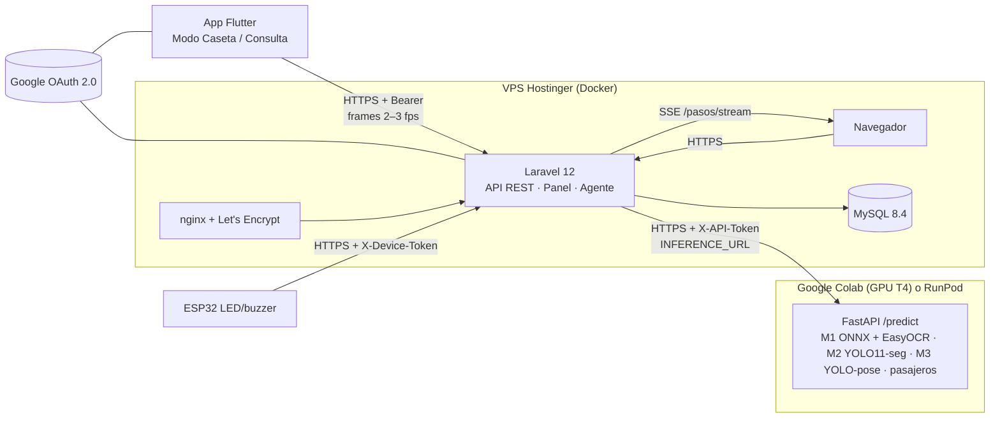

# Sistema Inteligente de Control de Peaje

**IAM-811 Machine Learning y Aprendizaje Profundo — Laboratorio Final de Hito (UNIFRANZ, 2026)**

Sistema de punta a punta que identifica vehículos a partir del video de una app móvil: lee la placa (M1 + OCR), clasifica el vehículo por segmentación de instancias (M2), cuenta los ejes con keypoints de llantas (M3) y cuenta pasajeros (bonificación). La aplicación web publicada en un subdominio HTTPS registra cada paso en tiempo real, genera alertas, aplica tarifas y ofrece un agente conversacional. El acceso es exclusivamente con Google.

## Integrantes

| Integrante | Rol |
|---|---|
| Matías Darío Mercier Rengel | Todo el desarrollo: datasets y entrenamiento (M2, M3), endpoint de inferencia, aplicación web, tiempo real, agente, app móvil, despliegue y documentación |

## Enlaces

| Recurso | URL |
|---|---|
| Aplicación web (producción) | https://peaje.xn--camaracomercioespaola-tbc.tech (peaje.camaracomercioespañola.tech) |
| Dataset M2 (Roboflow) | `matias-dario-mercier-rengel/car-motorcycle-bus-truck-ghnhh-gu1ay` v1 — basado en el dataset público de Universe `new-workspace-heijb/car-motorcycle-bus-truck-ghnhh` |
| Dataset M3 (Roboflow) | `matias-dario-mercier-rengel/llantas-ejes` v1 (fotos propias + Universe, keypoints corregidos a mano) |
| Endpoint de inferencia | Google Colab + Cloudflare Tunnel (URL temporal, configurada como `INFERENCE_URL`) o RunPod (`https://<POD_ID>-8000.proxy.runpod.net`) |

## Arquitectura



La web no depende de dónde corre la inferencia: cambiar entre Colab y RunPod es cambiar `INFERENCE_URL` en el `.env`.

## Tecnologías

- **Modelos:** YOLOv9-t (ONNX, placas) + EasyOCR · YOLO11n-seg (tipo de vehículo, máscaras generadas con SAM 2.1 a partir de las cajas) · YOLO11-pose (5 keypoints por llanta) · YOLO11n-seg COCO (pasajeros).
- **Datasets y entrenamiento:** Roboflow, Google Colab (GPU T4), Ultralytics.
- **Inferencia:** FastAPI + Uvicorn, ONNX Runtime, PyTorch/CUDA, entorno **mamba** (`inferencia/environment.yml`).
- **Web:** Laravel 12 (PHP 8.3), Blade + Tailwind, MySQL 8.4, Server-Sent Events, Docker Compose, nginx, Let's Encrypt.
- **Móvil:** Flutter 3.50 (Android), `camera`, `google_sign_in`, conversión YUV→JPEG en isolate.
- **Hardware:** ESP32 (Arduino) con LEDs y buzzer.

## Estructura del repositorio

| Carpeta | Contenido (equivalente en el enunciado) |
|---|---|
| `Notebooks/` | Notebooks de Colab: entrenamiento M2 y M3, servidor de inferencia (normal y con mamba), entorno de entrenamiento (`/entrenamiento`) |
| `inferencia/` | `servidor_unificado.py` (endpoint de los 3 modelos + pasajeros), `environment.yml`, `requirements.txt`, `Dockerfile`, `runpod_start.sh`, `diagnostico.py` (`/inferencia`) |
| `placas-web/` | Aplicación web Laravel: API, panel en tiempo real, agente, Docker (`/web`) |
| `IAM_yolo_native_app-main/` | App móvil Flutter (`/movil`) |
| `hardware/esp32_alerta/` | Sketch del dispositivo de alerta ESP32 |
| `docs/` | Colección Postman de la API, guías de despliegue (VPS, RunPod, entornos), punto de partida, prompt del informe |

## Despliegue

### 1. Entrenamiento (Colab)
1. `Notebooks/entrenamiento_m2_segmentacion_vehiculos_roboflow.ipynb` → GPU T4 → *Ejecutar todas*. Pide workspace/proyecto/versión de Roboflow y la API key (oculta). Guarda `MyDrive/peaje_modelos/m2_best.pt` y `evidencias_m2/`.
2. `Notebooks/keypoints_llantas_yolo_detectron2_v3.ipynb`, sección 8 (8.1 → 8.2 → Roboflow → 8.2b → 8.3 → 8.3b). Guarda `llantas_best.pt` y `evidencias_m3/`.

### 2. Inferencia (Colab o RunPod)
- **Colab:** `Notebooks/servidor_inferencia_peaje_colab_mamba.ipynb` → GPU T4 → *Ejecutar todas*. Crea el entorno mamba, carga los modelos desde Drive, pide el token y publica la URL con Cloudflare Tunnel.
- **RunPod:** ver `docs/RUNPOD.md` (`bash inferencia/runpod_start.sh`).

### 3. Web (VPS con Docker)
```bash
git clone <este repositorio> && cd placas-web
cp .env.example .env            # completar APP_KEY, DB_*, GOOGLE_*, INFERENCE_URL, INFERENCE_API_TOKEN, DEVICE_TOKEN
# docker/db.env con MYSQL_DATABASE, MYSQL_USER, MYSQL_PASSWORD, MYSQL_ROOT_PASSWORD
docker compose up -d --build    # app (php-fpm), web (nginx 127.0.0.1:8081), db (MySQL)
docker compose exec -u www-data app php artisan migrate --seed --force
```
nginx del host hace proxy del subdominio a `127.0.0.1:8081` (sin buffer en `/pasos/stream`) y certbot emite el certificado. Detalle en `docs/DESPLIEGUE_VPS.md`.

### 4. App móvil
```powershell
cd IAM_yolo_native_app-main
flutter build apk --release --dart-define=API_BASE_URL=https://peaje.xn--camaracomercioespaola-tbc.tech --dart-define=GOOGLE_WEB_CLIENT_ID=<client_id_web>.apps.googleusercontent.com
```
En Google Cloud: cliente OAuth web (redirect `https://<subdominio>/auth/google/callback`) y cliente Android (paquete `com.example.yolo_native_app` + SHA-1 del certificado de firma).

### 5. Dispositivo ESP32
Ver `hardware/esp32_alerta/README.md`.

## Entornos (bonificación)

Cada servicio tiene su entorno con versiones fijadas: `inferencia/environment.yml` (mamba, `peaje-inferencia`), `Notebooks/environment-entrenamiento.yml` (mamba, `peaje-entrenamiento`) y la web en Docker con `composer.lock`. Recrear y diagnosticar: `docs/ENTORNOS.md`.

```bash
mamba env create -f inferencia/environment.yml && conda activate peaje-inferencia
python inferencia/diagnostico.py --lock
```

## API

Documentada en `docs/api_peaje_postman_collection.json`. Todas las rutas, salvo `POST /api/v1/auth/google`, exigen `Authorization: Bearer <token>` (el dispositivo usa `X-Device-Token`).

| Método | Ruta | Descripción |
|---|---|---|
| POST | `/api/v1/auth/google` | idToken de Google → token del sistema (lista blanca) |
| POST | `/api/v1/pasos/frame` | Frame → inferencia → paso, tarifa, alerta, SSE |
| POST | `/api/v1/placas/consultar` | Estado de una placa por texto |
| POST | `/api/v1/placas/consultar-imagen` | Estado de una placa por imagen |
| GET | `/api/v1/placas/{placa}/historial` | Historial de pasos |
| GET | `/api/v1/casetas` · `/api/v1/casetas/{id}/resumen` | Casetas y resumen del día |
| POST | `/api/v1/agente/chat` | Agente conversacional |
| GET | `/api/v1/placas-filtradas` | Placas 2…2 con M |
| GET | `/api/v1/dispositivo/estado` | Estado para el ESP32 |
| CRUD | `/api/v1/vehiculos` | Vehículos (admin) |

## Seguridad

Ningún secreto está en el repositorio: solo `.env.example` y `secrets.example.h`. Tokens, client secret de Google, contraseñas de base de datos y API keys de Roboflow se configuran en el servidor o se ingresan de forma oculta en Colab.
